# Week 11.2: การตรวจความปลอดภัย การสอบสวน การบันทึก และการรายงานอุบัติเหตุ (Safety Inspection, Accident Investigation, Recording and Reporting)

---

## 🎯 วัตถุประสงค์การเรียนรู้ประจำบท (Learning Objectives)

เมื่อศึกษาเนื้อหาในบทเรียนนี้ครบถ้วนแล้ว ผู้เรียนจะมีความสามารถดังต่อไปนี้:
1. **เข้าใจสัดส่วนสาเหตุการเกิดอุบัติเหตุตามทฤษฎีไฮน์ริช (Heinrich's Domino Theory)** และอธิบายวัตถุประสงค์สำคัญของการตรวจความปลอดภัยเชิงรุก
2. **อธิบายโครงสร้างและบทบาทหน้าที่ของคณะกรรมการความปลอดภัย อาชีวอนามัย และสภาพแวดล้อมในการทำงาน (คปอ.)** และบุคลากรทุกระดับตามกฎหมายแรงงานไทย
3. **จำแนกประเภทของการตรวจความปลอดภัยทั้ง 4 รูปแบบ** และปฏิบัติตามขั้นตอนการตรวจความปลอดภัยในสถานประกอบกิจการได้อย่างถูกต้อง
4. **ประยุกต์ใช้เทคนิค 5W-1H และเครื่องมือในการสอบสวนอุบัติเหตุ** เพื่อค้นหาสาเหตุรากเหง้า (Root Cause Analysis: RCA) จากเหตุการณ์จริง
5. **เข้าใจเกณฑ์การจำแนกอุบัติเหตุและเหตุการณ์เกือบเกิดอุบัติเหตุ (Near-Miss)** ที่จำเป็นต้องทำการสอบสวนและบันทึก
6. **วิเคราะห์ความสูญเสียจากอุบัติเหตุ (ต้นทุนทางตรงและต้นทุนทางอ้อม)** ตามแบบจำลองภูเขาน้ำแข็ง (Iceberg Theory)
7. **คำนวณและแปลผลดัชนีชี้วัดสถิติความปลอดภัยสากล (LTIFR, LTISR, FSI)** ตลอดจนระบุข้อกำหนดในการจัดทำรายงานอุบัติเหตุตามกฎหมายไทย (แบบ จป.3, จป.4, กท.16, กท.44)

---

## 🧭 แผนผังภาพรวมระบบการตรวจและจัดการอุบัติเหตุ (Safety Inspection & Incident Management Cycle)

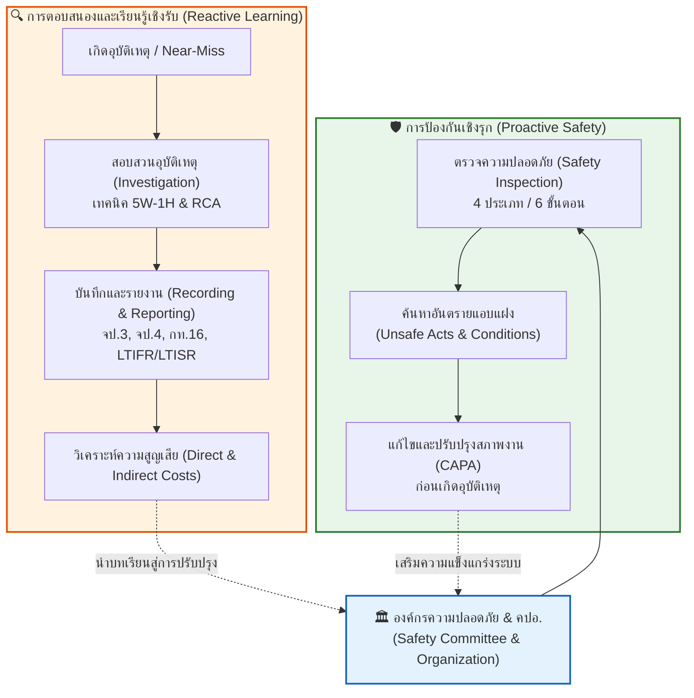

---

## 11.2 บทนำและสาเหตุพื้นฐานของการเกิดอุบัติเหตุ (Fundamental Causes of Accidents)

จากการศึกษาทางสถิติอุบัติเหตุในภาคอุตสาหกรรมโดย **เอช. ดับเบิลยู. ไฮน์ริช (H.W. Heinrich)** ซึ่งเป็นบิดาแห่งวิศวกรรมความปลอดภัยเชิงอุตสาหกรรม พบว่าสาเหตุของอุบัติเหตุสามารถจำแนกออกเป็นสัดส่วนสำคัญ 3 กลุ่ม ดังนี้:

  

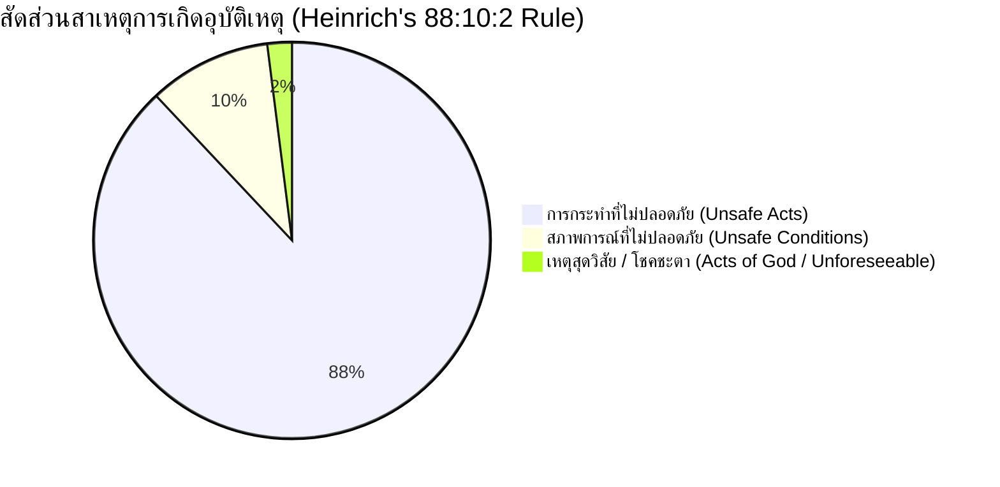

1. **การกระทำที่ไม่ปลอดภัย (Unsafe Acts) คิดเป็น 88%:**  
   เกิดจากพฤติกรรมของบุคคล เช่น ความประมาทเลินเล่อ ความรีบร้อน การไม่สวมใส่อุปกรณ์คุ้มครองความปลอดภัยส่วนบุคคล (PPE) การลัดขั้นตอนการทำงาน การหยอกล้อในขณะทำงาน หรือการทำงานโดยไม่มีอำนาจหน้าที่
2. **สภาพการณ์ที่ไม่ปลอดภัย (Unsafe Conditions) คิดเป็น 10%:**  
   เกิดจากความบกพร่องทางกายภาพ สิ่งแวดล้อม หรือเครื่องจักรกล เช่น เครื่องจักรไม่มีการ์ดป้องกัน พื้นทางเดินเปียกลื่น สายไฟฟ้าชำรุด ระบบระบายอากาศไม่เพียงพอ แสงสว่างไม่เหมาะสม หรือโครงสร้างอาคารชำรุด
3. **เหตุสุดวิสัยหรือภัยธรรมชาติ (Acts of God / Unforeseeable Events) คิดเป็น 2%:**  
   เป็นเหตุการณ์ที่อยู่นอกเหนือการควบคุมของมนุษย์ เช่น แผ่นดินไหว พายุฟ้าผ่ารุนแรง หรือน้ำท่วมฉับพลัน

> [!NOTE] ข้อพิจารณาทางวิศวกรรมความปลอดภัยยุคใหม่
> แม้สถิติจะระบุว่า 88% เกิดจากพฤติกรรมของคน (Unsafe Acts) แต่วิศวกรความปลอดภัยสมัยใหม่ตระหนักดีว่า **"พฤติกรรมที่ไม่ปลอดภัยมักมีต้นตอมาจากสภาพแวดล้อม การออกแบบ หรือระบบการบริหารจัดการที่บกพร่อง"** ดังนั้น การป้องกันอุบัติเหตุที่มีประสิทธิผลจึงต้องเริ่มจากการกำจัดจุดอันตรายด้วยระบบวิศวกรรมและการออกแบบระบบที่ไม่ยอมให้ความผิดพลาดของมนุษย์นำไปสู่การบาดเจ็บ (Fail-Safe & Poka-Yoke)

---

## 11.2.1 วัตถุประสงค์ของการตรวจความปลอดภัย (Objectives of Safety Inspection)

  

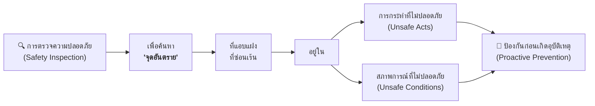

### เป้าหมายหลักของการตรวจความปลอดภัย:
1. **เพื่อค้นหาจุดอันตรายที่แอบแฝงซ่อนเร้น (Latent Hazards):** อันตรายหลายอย่างไม่สามารถมองเห็นได้ชัดเจนในสภาวะปกติ เช่น ความล้าของโลหะ การรั่วซึมของสารเคมี หรือพฤติกรรมลัดขั้นตอนของพนักงานเมื่อไม่มีหัวหน้างานดูแล
2. **เพื่อตรวจสอบสภาพความพร้อมของเครื่องจักร อุปกรณ์ และสิ่งแวดล้อม:** ให้มั่นใจว่าระบบความปลอดภัยและการ์ดป้องกันยังคงทำงานได้อย่างสมบูรณ์
3. **เพื่อส่งเสริมการสื่อสารและการสอนงานด้านความปลอดภัย (Safety Coaching):** เป็นโอกาสที่ผู้ตรวจจะได้ชี้แนะวิธีการทำงานที่ถูกต้องแก่พนักงานหน้างานโดยตรง
4. **เพื่อปรับเปลี่ยนกรอบความคิด:** มุ่งเน้น **"การค้นหาข้อเท็จจริงเพื่อแก้ไขปรับปรุงระบบ (Fact-Finding)"** มากกว่าการจับผิดเพื่อลงโทษพนักงาน (Fault-Finding)

---

## 11.2.2 การจัดตั้งหน่วยงานความปลอดภัยและคณะกรรมการความปลอดภัย (Safety Organization & Safety Committee)

ตาม **กฎกระทรวงการจัดให้มีเจ้าหน้าที่ความปลอดภัยในการทำงาน บุคลากร หน่วยงาน หรือคณะบุคคลเพื่อดำเนินการด้านความปลอดภัยในสถานประกอบกิจการ พ.ศ. 2565** (ออกตามความในพระราชบัญญัติความปลอดภัย อาชีวอนามัย และสภาพแวดล้อมในการทำงาน พ.ศ. 2554) กำหนดให้นายจ้างในสถานประกอบกิจการตามประเภทและขนาดที่กำหนด ต้องจัดให้มี **คณะกรรมการความปลอดภัย อาชีวอนามัย และสภาพแวดล้อมในการทำงาน (คปอ.)**

  

### เกณฑ์จำนวนคณะกรรมการความปลอดภัยฯ (คปอ.) ขั้นต่ำตามกฎหมาย

| จำนวนลูกจ้างในสถานประกอบการ | จำนวนกรรมการรวมขั้นต่ำ | ผู้แทนนายจ้างระดับบังคับบัญชา | ผู้แทนลูกจ้างระดับปฏิบัติการ | ประธานกรรมการ | เลขานุการกรรมการ |
| :---: | :---: | :---: | :---: | :---: | :---: |
| **50 – 99 คน** | **ไม่น้อยกว่า 5 คน** | 1 คน | 2 คน | นายจ้างหรือผู้แทนนายจ้างระดับบริหาร (1 คน) | จป.วิชาชีพ หรือ จป.เทคนิคขั้นสูง (1 คน) |
| **100 – 499 คน** | **ไม่น้อยกว่า 7 คน** | 2 คน | 3 คน | นายจ้างหรือผู้แทนนายจ้างระดับบริหาร (1 คน) | จป.วิชาชีพ (1 คน) |
| **500 คนขึ้นไป** | **ไม่น้อยกว่า 11 คน** | 4 คน | 5 คน | นายจ้างหรือผู้แทนนายจ้างระดับบริหาร (1 คน) | จป.วิชาชีพ (1 คน) |

*(ที่มา: กฎกระทรวงการจัดให้มีเจ้าหน้าที่ความปลอดภัยในการทำงานฯ พ.ศ. 2565 กระทรวงแรงงาน)*

> [!IMPORTANT] กฎหมายและแนวปฏิบัติเกี่ยวกับ คปอ.
> * **วาระการดำรงตำแหน่ง:** กรรมการ คปอ. มีวาระการดำรงตำแหน่งคราวละ **2 ปี**
> * **การประชุม:** ต้องจัดให้มีการประชุมอย่างน้อย **เดือนละ 1 ครั้ง**
> * **การรายงาน:** นายจ้างต้องส่งรายงานผลการดำเนินงานของ คปอ. (แบบ จป.3) ให้แก่กรมสวัสดิการและคุ้มครองแรงงานทุกไตรมาส

---

## 11.2.3 บทบาทหน้าที่ของผู้มีส่วนเกี่ยวข้อง (Roles and Responsibilities of Stakeholders)

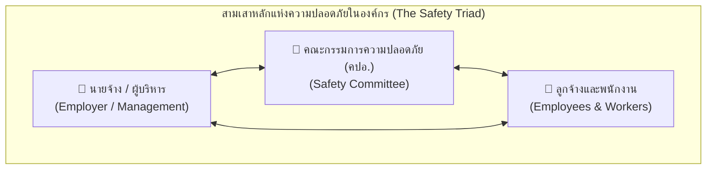

### 11.2.3.1 บทบาทหน้าที่ของคณะกรรมการความปลอดภัยฯ (คปอ.)
1. **พิจารณานโยบายและแผนงาน:** กำหนดนโยบาย แผนงาน ระเบียบ และมาตรฐานความปลอดภัยในการทำงาน เสนอต่อนายจ้าง
2. **สำรวจและตรวจสอบความปลอดภัย:** ดำเนินการสำรวจความปลอดภัย อาชีวอนามัย และสภาพแวดล้อมในการทำงานอย่างน้อยเดือนละ 1 ครั้ง และร่วมตรวจสอบกรณีเกิดอุบัติเหตุร้ายแรง
3. **ส่งเสริมและสนับสนุนกิจกรรม:** รณรงค์และจัดกิจกรรมกระตุ้นจิตสำนึกด้านความปลอดภัยของพนักงาน
4. **รับฟังข้อร้องเรียนและข้อคิดเห็น:** พิจารณาข้อร้องเรียนและข้อเสนอแนะด้านความไม่ปลอดภัยจากพนักงาน เพื่อเสนอมาตรการแก้ไขต่อนายจ้าง
5. **รายงานและประเมินผล:** รายงานผลการดำเนินงานและสถิติอุบัติเหตุประจำปีต่อนายจ้าง

### 11.2.3.2 บทบาทหน้าที่ของนายจ้างต่อความปลอดภัย (Employer's Responsibilities)
1. **สนับสนุนทรัพยากรและงบประมาณ:** จัดสรรงบประมาณ เครื่องมือ และเวลาทำงานสำหรับการดำเนินงานของ คปอ.
2. **รับฟังและปฏิบัติตามคำแนะนำ:** นำข้อเสนอแนะด้านความปลอดภัยจาก คปอ. ไปสั่งการและปรับปรุงแก้ไขอย่างเป็นรูปธรรม
3. **เปิดเผยข้อมูลที่เป็นจริง:** แสดงข้อมูลสถิติ สภาพแวดล้อม สารเคมี และประวัติอุบัติเหตุแก่ คปอ. อย่างโปร่งใส
4. **รับผิดชอบทางกฎหมาย:** รับผิดชอบสูงสุดต่อความปลอดภัยและสุขอนามัยของลูกจ้างทุกคนในสถานประกอบกิจการ

### 11.2.3.3 บทบาทหน้าที่ของพนักงานและลูกจ้าง (Employees' Responsibilities)
1. **ให้ความร่วมมือ:** เข้าร่วมกิจกรรมความปลอดภัย และปฏิบัติตามกฎระเบียบข้อบังคับอย่างเคร่งครัด
2. **ยอมรับและเชื่อมั่น:** ปรับเปลี่ยนทัศนคติและพฤติกรรมการทำงานให้ปลอดภัย โดยตระหนักว่าความปลอดภัยเป็นหน้าที่ของทุกคน
3. **ให้ข้อมูลข้อเท็จจริง:** รายงานเหตุการณ์และสภาพแวดล้อมตามความเป็นจริงแก่ผู้ตรวจหรือทีมสอบสวน
4. **กล้าแสดงออกและใช้สิทธิ:** เสนอแนะจุดอันตราย หรือใช้สิทธิหยุดการทำงานชั่วคราว (Stop Work Authority) เมื่อพบว่างานมีความเสี่ยงร้ายแรงถึงชีวิต

---

## 11.2.4 บทบาทหน้าที่ของฝ่ายต่าง ๆ ในองค์กรที่เกี่ยวกับความปลอดภัย (Cross-Functional Departmental Roles)

ความปลอดภัยไม่ใช่หน้าที่ของฝ่าย จป. เพียงฝ่ายเดียว แต่ต้องบูรณาการเข้ากับทุกสายงานในองค์กร:

| หน่วยงาน | บทบาทหน้าที่และความรับผิดชอบด้านความปลอดภัย |
| :--- | :--- |
| **1. ฝ่ายบุคคล (HR)** | • คัดเลือกและจัดหาบุคลากรที่มีสุขภาพและคุณสมบัติเหมาะสมกับลักษณะงาน • จัดให้มีการตรวจสุขภาพพนักงานใหม่ก่อนเข้าทำงาน (Pre-employment Check) และตรวจสุขภาพประจำปีตามปัจจัยเสี่ยง • จัดทำแผนการฝึกอบรมความปลอดภัยปฐมนิเทศและหลักสูตรกฎหมายบังคับ • ติดตามกฎหมายแรงงานและความปลอดภัยที่ปรับปรุงใหม่ |
| **2. ฝ่ายบัญชีและการเงิน** | • จัดสรรงบประมาณด้านความปลอดภัย อุปกรณ์ PPE และระบบป้องกันอย่างเหมาะสม • จัดทำบัญชีและติดตามต้นทุนค่าใช้จ่ายทั้งหมดที่เกิดจากอุบัติเหตุ (ต้นทุนทางตรงและทางอ้อม) |
| **3. ฝ่ายจัดซื้อ** | • จัดหาเครื่องจักร อุปกรณ์ และสารเคมีที่ได้มาตรฐานความปลอดภัย (มอก., ISO, CE) • บังคับให้ผู้ขายแนบเอกสารข้อมูลความปลอดภัยสารเคมี (Safety Data Sheet: SDS) และคู่มือการใช้งาน • จัดหาอุปกรณ์คุ้มครองความปลอดภัยส่วนบุคคล (PPE) ที่ผ่านการรับรองมาตรฐานสากล |
| **4. ฝ่ายวิศวกรรม** | • ออกแบบเครื่องจักร สายการผลิต และสิ่งอำนวยความสะดวกตามหลักวิศวกรรมความปลอดภัย (Inherently Safer Design) • ตรวจสอบให้แบบก่อสร้างและการดัดแปลงไม่ขัดต่อกฎหมายความปลอดภัย • ร่วมปรับปรุงสภาพแวดล้อมทางวิศวกรรม เช่น ระบบระบายอากาศ การ์ดป้องกันเครื่องจักร |
| **5. ฝ่ายซ่อมบำรุง** | • จัดทำประวัติเครื่องจักรและดำเนินการบำรุงรักษาเชิงป้องกัน (Preventive Maintenance: PM) • วิเคราะห์จุดอันตรายของเครื่องจักรและปรับปรุงระบบนิรภัย (Safety Devices & Interlocks) • นำระบบตัดแยกพลังงานอันตราย **Lockout/Tagout (LOTO)** มาใช้ในงานซ่อมแซมอย่างเคร่งครัด |
| **6. ฝ่ายควบคุมคุณภาพ (QC/QA)** | • ควบคุมการผลิตให้เป็นไปตามมาตรฐานเพื่อความปลอดภัยของผู้บริโภคและผู้ปฏิบัติงาน • วิเคราะห์ข้อบกพร่องและจุดอันตรายของกระบวนการผลิต (เช่น FMEA) เพื่อร่วมปรับปรุงงาน |
| **7. ฝ่ายการตลาดและประชาสัมพันธ์** | • จัดทำข้อมูลฉลากคำเตือนและเอกสารแนะนำความปลอดภัยของผลิตภัณฑ์ให้แก่ลูกค้า • สื่อสารภาพลักษณ์และผลงานด้านความรับผิดชอบต่อสังคมและสิ่งแวดล้อม (CSR & ESG) |
| **8. ฝ่ายคลังสินค้าและการขนส่ง** | • จัดเก็บสินค้าและสารเคมีตามหลักการจัดเก็บที่ปลอดภัย (Separation & Segregation) • ควบคุมความปลอดภัยในการขับขี่รถฟอร์กลิฟต์และการจัดวางพาเลท • ตรวจเช็กสภาพยานพาหนะและควบคุมพฤติกรรมพนักงานขับรถขนส่งสินค้าภายนอก |

---

## 11.2.5 บทบาทหน้าที่ของบุคคลตามสายการบังคับบัญชา (Safety Roles Across Hierarchy)

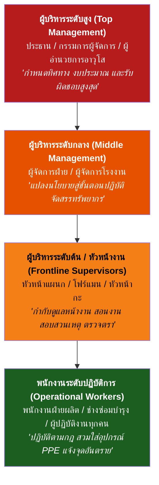

### 11.2.5.1 ผู้บริหารระดับสูง (Top Management)
* ประกอบด้วย: ประธานบริษัท, รองผู้จัดการใหญ่, ผู้อำนวยการอาวุโส
1. กำหนดนโยบายและเป้าหมายวิสัยทัศน์ความปลอดภัย (Safety Policy) และประกาศให้ทุกคนรับทราบ
2. จัดสรรทรัพยากรและงบประมาณด้านความปลอดภัยอย่างเพียงพอ
3. จัดตั้งโครงสร้างองค์กรความปลอดภัยและคณะกรรมการ คปอ.
4. ติดตามและทบทวนผลการดำเนินงานด้านความปลอดภัยในการประชุมฝ่ายบริหารอย่างสม่ำเสมอ
5. แสดงภาวะผู้นำด้านความปลอดภัย (Safety Leadership) ด้วยการเป็นแบบอย่างที่ดี

### 11.2.5.2 ผู้บริหารระดับกลาง (Middle Management)
* ประกอบด้วย: ผู้จัดการโรงงาน, ผู้จัดการฝ่ายบุคคล, ผู้จัดการฝ่ายผลิต, ผู้จัดการฝ่ายวิศวกรรม
1. ถ่ายทอดนโยบายของผู้บริหารระดับสูงลงสู่แผนปฏิบัติการระดับหน่วยงาน
2. จัดทำขั้นตอนการปฏิบัติงานที่ปลอดภัย (Safe Work Procedures: SWP) และข้อบังคับความปลอดภัย
3. ขจัดอุปสรรคและสนับสนุนงบประมาณในการปรับปรุงจุดอันตรายของหน่วยงานใต้บังคับบัญชา
4. ติดตามสถิติอุบัติเหตุและการประเมินความเสี่ยงในสายงานของตน
5. รับผิดชอบต่อความปลอดภัยของพนักงานทุกคนในแผนกที่ตนเองดูแล

### 11.2.5.3 ผู้บริหารระดับต้น / หัวหน้างาน (Frontline Supervisors)
* ประกอบด้วย: หัวหน้าแผนก, หัวหน้างาน (Supervisor), หัวหน้ากะ, โฟร์แมน (Foreman)
> [!TIP] หัวหน้างาน: กุญแจสำคัญที่สุดของความปลอดภัยหน้างาน
> หัวหน้างานคือผู้ที่อยู่ใกล้ชิดกับพนักงานและหน้างานมากที่สุด ความสำเร็จหรือล้มเหลวของความปลอดภัยขึ้นอยู่กับบทบาทของหัวหน้างานเป็นหลัก

1. จัดการอบรมความปลอดภัยหน้างานและการพูดคุยความปลอดภัยประจำวัน (Toolbox Talk)
2. ตรวจตราสภาพการทำงานและพฤติกรรมของพนักงานอย่างสม่ำเสมอ (Unannounced Inspections)
3. ตักเตือนและแก้ไขการทำงานที่ไม่ปลอดภัยทันทีที่พบเห็น
4. ดำเนินการสอบสวน บันทึก และรายงานอุบัติเหตุหรือเหตุการณ์เกือบเกิดอุบัติเหตุทันที
5. ปรับปรุงจุดอันตรายและสภาพแวดล้อมที่ได้รับมอบหมายให้แล้วเสร็จตามกำหนด

### 11.2.5.4 พนักงานระดับปฏิบัติการ (Operational Workers)
* ประกอบด้วย: ช่างเทคนิค, พนักงานฝ่ายผลิต, พนักงานคลังสินค้า, ผู้ปฏิบัติงานทุกคน
1. เคร่งครัดในขั้นตอนและข้อบังคับความปลอดภัยในการทำงาน
2. ตรวจสอบเครื่องจักร เครื่องมือ และอุปกรณ์ PPE ก่อนเริ่มทำงานทุกครั้ง
3. สวมใส่และดูแลรักษาอุปกรณ์คุ้มครองความปลอดภัยส่วนบุคคลอย่างถูกต้อง
4. รายงานสภาพการณ์และเครื่องมือที่ชำรุดเสียหายต่อหัวหน้างานทันที
5. หลีกเลี่ยงการใช้เครื่องจักรหรือสารเคมีที่ตนเองไม่ได้รับการฝึกอบรมหรือไม่มีความชำนาญ

---

## 11.2.6 บทบาทหน้าที่ของเจ้าหน้าที่ความปลอดภัยในการทำงาน (Safety Officers: จป.)

ตามกฎกระทรวงฯ พ.ศ. 2565 กำหนดให้มีเจ้าหน้าที่ความปลอดภัยในการทำงาน (จป.) 5 ระดับ ได้แก่:
1. **จป. ระดับบริหาร** (นายจ้างหรือผู้บริหารระดับสูง)
2. **จป. ระดับหัวหน้างาน** (หัวหน้างานตามสายการผลิต)
3. **จป. ระดับเทคนิค**
4. **จป. ระดับเทคนิคขั้นสูง**
5. **จป. ระดับวิชาชีพ** (ผู้สำเร็จการศึกษาปริญญาตรีสาขาอาชีวอนามัยและความปลอดภัย หรือเทียบเท่า)

### บทบาทหน้าที่หลักของเจ้าหน้าที่ความปลอดภัยในการทำงานระดับวิชาชีพ:
1. **จัดทำแผนงานและข้อเสนอแนะ:** จัดทำแผนงานโครงการความปลอดภัย เสนอต่อนายจ้างและ คปอ.
2. **ตรวจตราความปลอดภัยเชิงรุก:** ตรวจสอบสภาพแวดล้อม สารเคมี แสงสว่าง เสียง และการปฏิบัติงานของลูกจ้าง
3. **สอบสวนและรายงานอุบัติเหตุ:** ดำเนินการสอบสวน วิเคราะห์สาเหตุรากเหง้า และจัดทำรายงานอุบัติเหตุร้ายแรง
4. **จัดทำรายงานตามกฎหมายแรงงาน:**
   * **แบบ จป.2:** แจ้งแต่งตั้ง จป. หรือ คปอ.
   * **แบบ จป.3:** รายงานผลการดำเนินงานของ จป.วิชาชีพ ส่งทุก 3 เดือน (รายไตรมาส)
   * **แบบ จป.4:** รายงานการประสบอันตราย เจ็บป่วย หรือสูญหายจากการทำงานร้ายแรง
5. **วิเคราะห์สถิติความปลอดภัย:** รวบรวมข้อมูลอุบัติเหตุ คำนวณดัชนีชี้วัดสากล (LTIFR, LTISR) และเสนอแนะมาตรการป้องกันเชิงระบบ

---

## 11.3 ประโยชน์ที่ได้รับจากการตรวจความปลอดภัย (Benefits of Safety Inspection)

1. **สร้างสัมพันธภาพและความไว้วางใจ:** เกิดการมีส่วนร่วมและการพูดคุยแลกเปลี่ยนระหว่างฝ่ายบริหาร หัวหน้างาน และผู้ปฏิบัติงาน
2. **การมีส่วนร่วมของพนักงาน (Employee Empowerment):** พนักงานมีช่องทางแสดงความคิดเห็นในการแก้ไขปัญหาหน้างาน
3. **ลดความสูญเสียทางเศรษฐกิจ:** ป้องกันการสูญเสียชีวิต การบาดเจ็บ ค่ารักษาพยาบาล และค่าซ่อมแซมเครื่องจักร
4. **กระตุ้นความตระหนักรู้อย่างต่อเนื่อง:** การตรวจอย่างสม่ำเสมอช่วยรักษามาตรฐานวินัยความปลอดภัยไม่ให้หย่อนยาน
5. **ส่งเสริมการสอนงาน (On-the-Job Coaching):** สามารถแก้ไขพฤติกรรมที่ไม่ปลอดภัยได้ทันที ณ จุดปฏิบัติงานจริง
6. **ยกระดับสุขอนามัยและ 5ส:** สถานที่ทำงานมีความสะอาด เป็นระเบียบเรียบร้อย ลดความเสี่ยงจากการลื่น หกล้ม และเพลิงไหม้

---

## 11.4 ประเภทของการตรวจความปลอดภัย (4 Types of Safety Inspection)

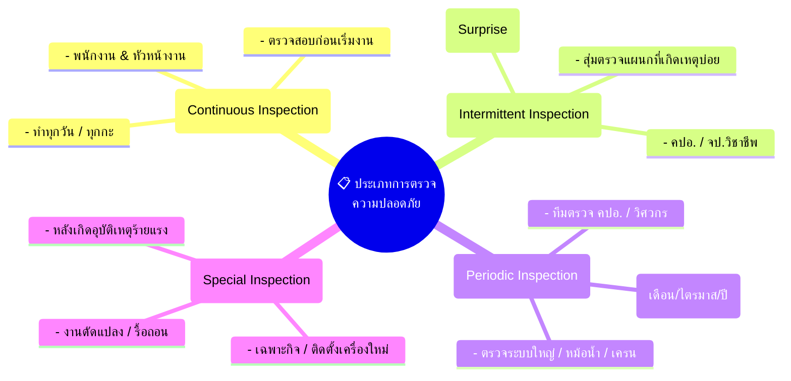

| ประเภทการตรวจ | ความถี่และลักษณะการตรวจ | ผู้รับผิดชอบหลัก | ตัวอย่างกิจกรรมและรายการตรวจ |
| :--- | :--- | :--- | :--- |
| **1. ตรวจแบบต่อเนื่อง (Continuous Inspection)** | ตรวจสอบเป็นประจำทุกวัน ทุกกะ หรือก่อนเริ่มเดินเครื่องจักร | พนักงานประจำเครื่อง, หัวหน้างาน | การตรวจเช็กสภาพเครื่องมือก่อนใช้ (Pre-operation Check), การตรวจรอยรั่วซึม, ความสะอาดทางเดิน, การสวมใส่ PPE |
| **2. ตรวจแบบไม่กำหนดช่วงเวลา (Intermittent / Unannounced)** | ไม่แจ้งล่วงหน้า ทำการสุ่มตรวจเมื่อมีข้อมูลบ่งชี้ หรือสถิติอุบัติเหตุในแผนกนั้นสูงขึ้น | ผู้จัดการต่างแผนก, จป.วิชาชีพ, ตัวแทน คปอ. | สุ่มตรวจพฤติกรรมการทำงานในกะดึก, ตรวจสอบการปฏิบัติตามระบบ Permit to Work, สุ่มตรวจการสวมใส่ PPE |
| **3. ตรวจตามกำหนดเวลา (Periodic Inspection)** | มีตารางและรอบเวลาชัดเจน (รายเดือน, ราย 3 เดือน, 6 เดือน หรือรายปี) | คณะกรรมการ คปอ., จป.วิชาชีพ, วิศวกรผู้เชี่ยวชาญ | ตรวจระบบดับเพลิง, ตรวจหม้อน้ำ (Boiler), ตรวจเครนและปั้นจั่น, ตรวจระบบไฟฟ้าแรงสูง, ตรวจพื้นที่รอบโรงงาน |
| **4. ตรวจกรณีพิเศษ (Special Inspection)** | ตรวจสอบเฉพาะกิจเมื่อมีสถานการณ์พิเศษ หรือมีความเสี่ยงสูงเกิดขึ้น | คณะทำงานพิเศษ, ผู้เชี่ยวชาญเฉพาะด้าน | ติดตั้งเครื่องจักรใหม่, ก่อสร้างอาคารใหม่, การรื้อถอนโครงสร้าง, การเปลี่ยนแปลงสารเคมีใหม่, ตรวจหลังเกิดภัยพิบัติ |

---

## 11.5 ขั้นตอนและกระบวนการตรวจความปลอดภัยอย่างเป็นระบบ (Systematic Safety Inspection Procedures)

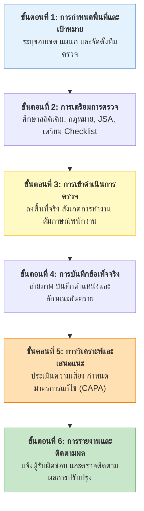

### รายละเอียดการปฏิบัติในแต่ละขั้นตอน:
1. **การกำหนดพื้นที่และเป้าหมาย (Scoping & Team Selection):** แบ่งพื้นที่โรงงานออกเป็นโซนที่ชัดเจน และจัดทีมผู้ตรวจที่ประกอบด้วยตัวแทนนายจ้าง ลูกจ้าง และ จป.
2. **การเตรียมการตรวจ (Preparation):**
   * ศึกษาสถิติอุบัติเหตุและข้อร้องเรียนในอดีตของแผนกนั้น
   * จัดเตรียม **แบบตรวจสอบความปลอดภัย (Safety Checklist)** ที่เหมาะสมกับลักษณะงาน
   * ศึกษาเอกสารการวิเคราะห์งานเพื่อความปลอดภัย (Job Safety Analysis: JSA)
3. **การเข้าดำเนินการตรวจหน้างาน (On-site Walkthrough):**
   * ตรวจดูทั้งสภาพแวดล้อมทางกายภาพและพฤติกรรมของพนักงาน
   * พูดคุยสอบถามพนักงานอย่างเป็นมิตร รับฟังปัญหาความไม่สะดวกในการทำงาน
   * หลีกเลี่ยงการขัดจังหวะการทำงานในจังหวะที่มีความเสี่ยงสูง
4. **การบันทึกข้อเท็จจริง (Fact Recording):**
   * จดบันทึกสิ่งที่พบเห็นอย่างละเอียด ระบุวัน เวลา สถานที่ และเครื่องจักร
   * ถ่ายภาพประกอบหลักฐานที่ชัดเจน (ทั้งมุมกว้างและมุมแคบ)
5. **การวิเคราะห์ปัญหาและจัดทำข้อเสนอแนะ (Analysis & Recommendation):**
   * ค้นหาสาเหตุที่แท้จริง ไม่มองแค่ผิวเผิน
   * กำหนดแนวทางแก้ไขตามหลัก **Hierarchy of Controls** โดยระบุผู้รับผิดชอบและวันแล้วเสร็จ (CAPA)
6. **การแจ้งผลและติดตามการปรับปรุง (Reporting & Follow-up):**
   * สรุปรายงานต่อผู้จัดการแผนกและที่ประชุม คปอ.
   * มีระบบตรวจติดตามซ้ำ (Follow-up Audit) เพื่อให้มั่นใจว่าอันตรายได้รับการแก้ไขจริง

---

## 11.6 จุดตรวจสอบความปลอดภัยที่สำคัญในสถานประกอบกิจการ (Critical Safety Inspection Checkpoints)

| จุดตรวจสอบสำคัญ | รายการที่ต้องตรวจสอบอย่างละเอียด (Checkpoints) |
| :--- | :--- |
| **1. ระบบไฟฟ้าและอุปกรณ์** | • สภาพสายไฟ ปลั๊ก เต้ารับ ไม่แตกหัก เปื่อย หรือมีรอยต่อพันเทปไม่เรียบร้อย • มีสายดิน (Grounding) และระบบตัดไฟรั่ว (RCD/ELCB) • ตู้ควบคุมไฟฟ้ามีฝาปิดสนิท ไม่มีสิ่งของวางกีดขวางในระยะ 1 เมตร และมีป้ายเตือนอันตรายไฟฟ้า |
| **2. เครื่องจักรและชิ้นส่วนหมุน** | • ติดตั้งการ์ดป้องกันจุดหมุน จุดตัด จุดหนีบ (Pulleys, Gears, Shafts, Blades) • ปุ่มหยุดฉุกเฉิน (Emergency Stop) อยู่ในตำแหน่งเข้าถึงง่ายและใช้งานได้ทันที • มีป้ายเตือนอันตรายและระบบ Interlock ไม่ถูกดัดแปลงหรือปลดล็อก |
| **3. สารเคมีอันตรายและวัตถุไวไฟ** | • ถังบรรจุมีฉลากชัดเจน (GHS Labels) และมีเอกสารข้อมูลความปลอดภัย (SDS) ประจำจุด • มีถาดรองรับการรั่วไหล (Spill Containment Pallets) และชุดดูดซับสารเคมี (Spill Kits) • มีอ่างล้างตาฉุกเฉินและฝักบัวชำระร่างกายที่ใช้งานได้ทันที และมีแรงดันน้ำสม่ำเสมอ |
| **4. สภาพแวดล้อมทั่วไปและกายภาพ** | • แสงสว่างเพียงพอต่อความละเอียดของงาน ไม่มีแสงจ้าบาดตา • ระดับเสียงดังไม่เกินมาตรฐานที่กฎหมายกำหนด (เกิน 85 dBA ต้องมีมาตรการอนุรักษ์การได้ยิน) • ทางเดินและทางออกฉุกเฉินโล่ง ไม่มีสิ่งของวางกีดขวาง ประตูหนีบไฟเปิดออกด้านนอกได้ตลอดเวลา |
| **5. การทำงานและสุขอนามัยของพนักงาน** | • พนักงานสวมใส่อุปกรณ์ PPE ที่ถูกต้องและเหมาะสมกับความเสี่ยง • ท่าทางการทำงานถูกต้องตามหลักการยศาสตร์ (Ergonomics) เช่น การยกของด้วยกำลังขา • พนักงานไม่หยอกล้อ ไม่ใช้โทรศัพท์มือถือขณะควบคุมเครื่องจักร หรือเดินในเส้นทางรถยก |

---

## 11.7 เหตุผลและความสำคัญในการสอบสวน บันทึก และรายงานอุบัติเหตุ (Accident Investigation Rationale)

> [!IMPORTANT] หัวใจของการสอบสวนอุบัติเหตุ
> **"เราสอบสวนอุบัติเหตุเพื่อค้นหาว่าระบบบกพร่องอย่างไร และจะป้องกันไม่ให้เกิดซ้ำได้อย่างไร มิใช่การมุ่งหาคนผิดมาลงโทษ" (Investigate to Find Root Causes and Prevent Recurrence, NOT to Blame)**

### เหตุผล 4 ประการที่ต้องสอบสวน บันทึก และรายงานอุบัติเหตุ:
1. **เพื่อค้นหาสาเหตุที่แท้จริง (Root Cause):** อุบัติเหตุเกือบทั้งหมดเป็นผลมาจากความบกพร่องสะสมในระบบ การสอบสวนช่วยเจาะลึกผ่านพฤติกรรมผิวเผินไปสู่รากเหง้าของปัญหา
2. **เพื่อนำข้อเท็จจริงมาสร้างความตระหนักรู้:** ข้อมูลจากเหตุการณ์จริงเป็นบทเรียนที่ดีที่สุดในการอบรมและเตือนใจพนักงานและผู้ควบคุมงาน
3. **เพื่อยกระดับมาตรการความปลอดภัย:** ข้อมูลที่ได้จะนำไปสู่การปรับปรุงขั้นตอนการทำงาน การออกแบบทางวิศวกรรม หรือการจัดซื้ออุปกรณ์ที่ปลอดภัยยิ่งขึ้น
4. **เพื่อจัดทำสถิติและปฏิบัติตามกฎหมาย:** รวบรวมข้อมูลสถิติเพื่อเปรียบเทียบมาตรฐานความปลอดภัย และเป็นหลักฐานทางกฎหมายในการยื่นรับเงินทดแทนจากกองทุนเงินทดแทน

---

## 11.8 การประยุกต์ใช้เทคนิค 5W-1H ในการสอบสวนอุบัติเหตุ (The 5W-1H Investigation Technique)

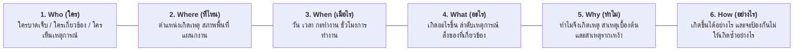

| คำถาม 5W-1H | ประเด็นคำถามที่ต้องเจาะลึก | ตัวอย่างการสืบสวนหน้างาน |
| :---: | :--- | :--- |
| **Who** | ใครคือผู้ประสบอุบัติเหตุ? ใครเป็นพยานรู้เห็น? ใครเป็นหัวหน้างาน? | นายสมชาย (อายุงาน 3 เดือน, แผนกตัดโลหะ, ผ่านการอบรมเบื้องต้นแล้ว) |
| **Where** | อุบัติเหตุเกิดขึ้นที่จุดไหนอย่างแม่นยำ? สภาพแวดล้อมรอบจุดเกิดเหตุเป็นอย่างไร? | บริเวณเครื่องเลื่อยสายพาน หมายเลข 4 แผนกแปรรูปโลหะ อาคาร B |
| **When** | เกิดขึ้นเมื่อวันใด เวลาใด? ผู้บาดเจ็บทำงานต่อเนื่องมากี่ชั่วโมงแล้ว? | วันที่ 14 ตุลาคม เวลา 15.45 น. (ทำงานกะเช้าต่อเนื่องเข้าสู่ชั่วโมงที่ 7) |
| **What** | เกิดอะไรขึ้นตามลำดับเวลา (Timeline)? อวัยวะใดบาดเจ็บ? ทรัพย์สินใดเสียหาย? | มือซ้ายไถลเข้าสัมผัสใบเลื่อยสายพาน เกิดแผลฉีกขาดลึกที่นิ้วชี้และนิ้วกลาง |
| **Why** | ทำไมมือจึงไถล? ทำไมเครื่องจักรจึงไม่มีการ์ด? ทำไมชิ้นงานจึงหลุดมือ? | ชิ้นงานมีคราบน้ำมันหล่อลื่น และการ์ดป้องกันถูกถอดออกระหว่างการปรับตั้งเครื่องแต่ไม่ได้ใส่คืน |
| **How** | กลไกการเกิดเหตุเป็นอย่างไร? และจะมีมาตรการแก้ไขป้องกันถาวรได้อย่างไร? | ติดตั้ง Interlock Guard ที่เครื่องจะไม่หมุนถ้าไม่มีการ์ด และจัดทำ Standard Work Procedure |

---

## 11.9 ระดับและประเภทของอุบัติเหตุที่ต้องทำการสอบสวน (Incidents Requiring Investigation)

ตามหลักการบริหารจัดการความปลอดภัยสมัยใหม่ องค์กรต้องไม่รอให้เกิดการบาดเจ็บรุนแรงจึงจะเริ่มทำการสอบสวน แต่ต้องสอบสวนเหตุการณ์ทุกระดับตาม **ทฤษฎีสามเหลี่ยมอุบัติเหตุของ แฟรงก์ อี. เบิร์ด (Frank E. Bird's Incident Triangle)**:

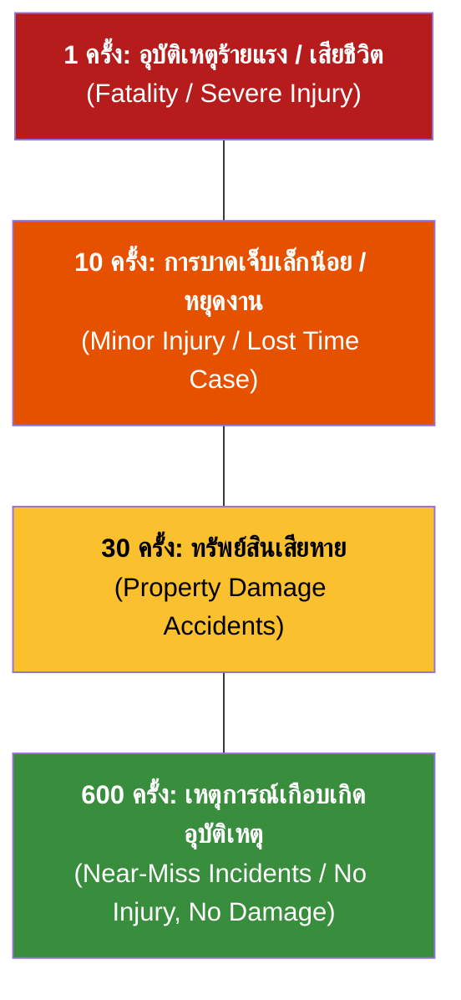

### รายการอุบัติเหตุและเหตุการณ์ที่ต้องทำการสอบสวน:
1. **เหตุการณ์เกือบเกิดอุบัติเหตุ (Near-Miss Incident):** เหตุการณ์ที่เกือบทำให้เกิดอันตราย เช่น ชิ้นงานเหล็กหล่นเฉียดศีรษะพนักงาน การสอบสวน Near-Miss คือการตัดไฟแต่ต้นลมที่มีประสิทธิภาพสูงสุด
2. **อุบัติเหตุปฐมพยาบาล (First Aid Case: FAC):** การบาดเจ็บเล็กน้อย เช่น มีดบาด แผลฟกช้ำ ที่สามารถทำแผลแล้วกลับไปปฏิบัติงานต่อได้ทันที
3. **อุบัติเหตุต้องรับการรักษาทางการแพทย์ (Medical Treatment Case: MTC):** การบาดเจ็บที่ต้องได้รับการตรวจรักษาโดยแพทย์ แต่ไม่ถึงขั้นต้องหยุดงาน
4. **อุบัติเหตุถึงขั้นหยุดงาน (Lost Time Injury: LTI):** พนักงานบาดเจ็บจนไม่สามารถมาปฏิบัติงานได้ในกะทำงานถัดไป
5. **อุบัติเหตุถึงขั้นสูญเสียอวัยวะหรือทุพพลภาพ (Permanent Disability):** สูญเสียนิ้ว ตาบอด หูหนวก หรืออัมพาต
6. **อุบัติเหตุร้ายแรงถึงแก่ชีวิต (Fatality):** มีผู้เสียชีวิตในสถานที่ทำงานหรือเสียชีวิตต่อเนื่องจากการบาดเจ็บในการทำงาน
7. **อุบัติเหตุต่อทรัพย์สินและเครื่องจักร (Property Damage):** ไฟไหม้ เครื่องจักรระเบิด สารเคมีรั่วไหลไหลลงสู่แหล่งน้ำสาธารณะ

---

## 11.10 เครื่องมือและอุปกรณ์ในชุดสอบสวนอุบัติเหตุ (Accident Investigation Kit)

เพื่อให้การรวบรวมพยานหลักฐานในสถานที่เกิดเหตุเป็นไปอย่างรวดเร็ว ถูกต้อง และไม่ถูกทำลาย ทีมสอบสวนความปลอดภัยควรมีกระเป๋าชุดอุปกรณ์สอบสวน (Investigation Kit) ที่พร้อมใช้งานตลอดเวลา:

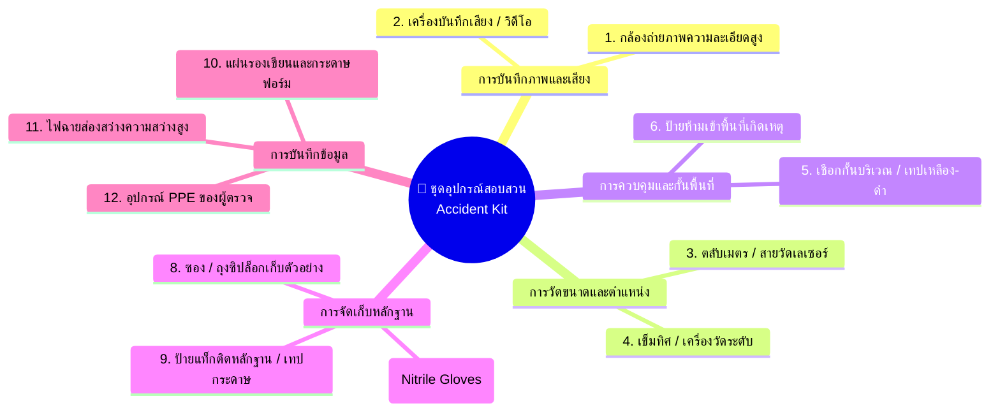

---

## 11.11 รูปแบบ โครงสร้าง และวิธีการรายงานอุบัติเหตุ (Accident Reporting Framework)

การรายงานอุบัติเหตุเป็นขั้นตอนสุดท้ายของการสอบสวน เพื่อถ่ายทอดข้อเท็จจริง สถิติ และมาตรการแก้ไขให้แก่ผู้บริหาร คปอ. และหน่วยงานราชการที่เกี่ยวข้อง

### 11.11.1 การรายงานเกี่ยวกับข้อเท็จจริงของอุบัติเหตุ (Incident Information & Timeline)
* **ข้อมูลทั่วไป:** วัน เวลา กะทำงาน สถานที่เกิดเหตุ แผนกงาน และผู้พบเห็นเหตุการณ์
* **ลำดับเหตุการณ์ (Chronological Timeline):** สรุปเหตุการณ์เป็นลำดับขั้นตอนก่อนเกิดเหตุ ขณะเกิดเหตุ และการตอบสนองฉุกเฉินหลังเกิดเหตุ
* **สาเหตุของการเกิดเหตุ (Causal Breakdown):**
  * *สาเหตุโดยตรง (Direct Causes):* การกระทำที่ไม่ปลอดภัย (Unsafe Acts) และสภาพการณ์ที่ไม่ปลอดภัย (Unsafe Conditions)
  * *สาเหตุรากเหง้า (Root Causes):* นโยบายการบริหาร การบำรุงรักษา การฝึกอบรม หรือระบบการควบคุมงานที่บกพร่อง
* **มาตรการแก้ไขและป้องกัน (CAPA):** ระบุมาตรการระยะสั้น (ทำทันที) และมาตรการระยะยาว พร้อมชื่อผู้รับผิดชอบและวันกำหนดเสร็จ

---

### 11.11.2 การรายงานเกี่ยวกับข้อมูลผู้ได้รับบาดเจ็บ (Injured Personnel Data & Medical Records)
* **ข้อมูลส่วนบุคคล:** ชื่อ-นามสกุล, ตำแหน่ง, อายุ, ประสบการณ์การทำงานในตำแหน่งปัจจุบัน, การผ่านการอบรมที่เกี่ยวข้อง
* **ข้อมูลทางการแพทย์:**
  * ลักษณะการบาดเจ็บตามมาตรฐาน ILO (Nature of Injury) เช่น แผลฉีกขาด กระดูกหัก แผลไหม้
  * อวัยวะที่ได้รับบาดเจ็บ (Location of Injury)
  * ระดับการรักษา: ปฐมพยาบาล, นำส่งคลินิก, หรือพักรักษาตัวในโรงพยาบาล (In-patient)
* **การประเมินวันหยุดงานและการชดเชย:** จำนวนวันที่แพทย์สั่งให้หยุดงานชั่วคราว การประเมินการสูญเสียสมรรถภาพของร่างกาย เพื่อประกอบการขอรับเงินทดแทนจากกองทุนเงินทดแทน

---

### 11.11.3 การรายงานเกี่ยวกับความเสียหายและต้นทุน (Accident Damage & Cost Analysis)

ความสูญเสียจากอุบัติเหตุไม่ได้มีเพียงค่ารักษาพยาบาล แต่เปรียบเสมือน **"ภูเขาน้ำแข็ง (The Safety Iceberg)"**:

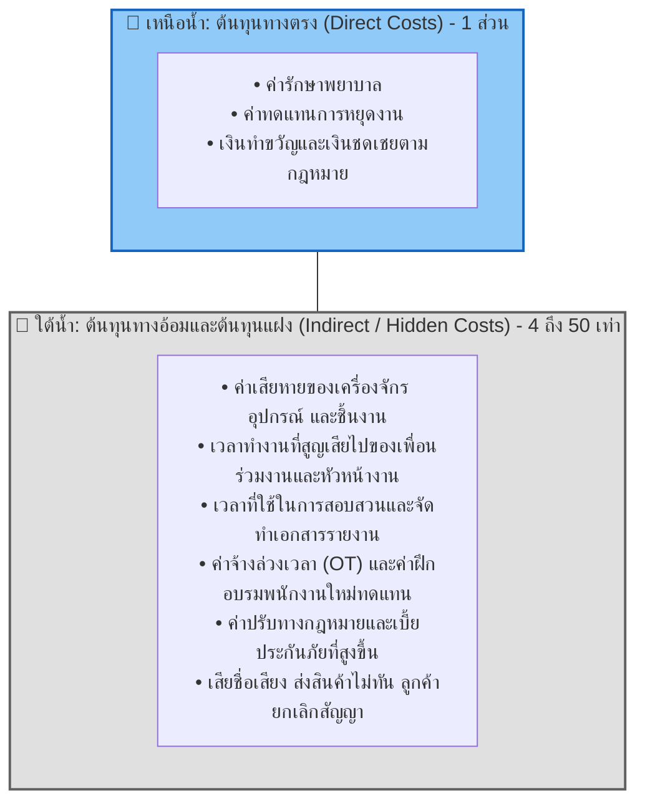

* **อัตราส่วนไฮน์ริช (Heinrich's Cost Ratio):** ต้นทุนทางตรง : ต้นทุนทางอ้อม = **1 : 4**
* **แบบจำลองของเบิร์ด (Bird's Iceberg Model):** ต้นทุนทางอ้อมที่มองไม่เห็นอาจสูงถึง **5 ถึง 50 เท่า** ของต้นทุนทางตรง

---

### 11.11.4 การรายงานเกี่ยวกับสถิติความปลอดภัยและการวิเคราะห์ดัชนีชี้วัด (Safety Metrics & Statistical Reporting)

การวัดผลการดำเนินงานด้านความปลอดภัยต้องคำนวณดัชนีชี้วัดตามมาตรฐานสากล (OSHA / ANSI Z16.1 / ILO) เพื่อนำไปเปรียบเทียบกับองค์กรอื่นในอุตสาหกรรมเดียวกัน:

#### 1) อัตราความถี่ของการเกิดอุบัติเหตุถึงขั้นหยุดงาน (Lost Time Injury Frequency Rate: LTIFR)

$$\text{LTIFR} = \frac{\text{จำนวนครั้งของการบาดเจ็บถึงขั้นหยุดงาน} \times 1,000,000}{\text{จำนวนชั่วโมงการทำงานรวมของลูกจ้างทั้งหมด (Total Man-Hours)}}$$

*หมายเหตุ: ตัวคูณ $1,000,000$ หมายถึงการเปรียบเทียบต่อการทำงานหนึ่งล้านชั่วโมงทำงานของพนักงาน*

#### 2) อัตราความรุนแรงของการเกิดอุบัติเหตุ (Lost Time Injury Severity Rate: LTISR)

$$\text{LTISR} = \frac{\text{จำนวนวันทำงานที่สูญเสียรวม} \times 1,000,000}{\text{จำนวนชั่วโมงการทำงานรวมของลูกจ้างทั้งหมด (Total Man-Hours)}}$$

#### 3) ดัชนีความถี่และความรุนแรงร่วม (Frequency Severity Index: FSI)

$$\text{FSI} = \sqrt{\frac{\text{LTIFR} \times \text{LTISR}}{1,000}}$$

---

### ตารางสรุปแบบฟอร์มการรายงานอุบัติเหตุตามกฎหมายไทย

| แบบฟอร์ม | หน่วยงานที่กำกับดูแล | วัตถุประสงค์และเงื่อนไขการส่งรายงาน | กำหนดเวลาส่งรายงาน |
| :---: | :--- | :--- | :--- |
| **แบบ จป.3** | กรมสวัสดิการและคุ้มครองแรงงาน | รายงานผลการดำเนินงานด้านความปลอดภัยของ จป.วิชาชีพ และสถิติอุบัติเหตุ | ทุก 3 เดือน (ภายใน 30 วันหลังสิ้นไตรมาส) |
| **แบบ จป.4** | กรมสวัสดิการและคุ้มครองแรงงาน | รายงานการประสบอันตราย เจ็บป่วย หรือสูญหายร้ายแรง (เสียชีวิต หรือหยุดงานตั้งแต่ 3 วันขึ้นไป) | ภายในระยะเวลาที่กฎหมายกำหนด (แจ้งเบื้องต้น 24 ชม. ส่งรายงาน 7 วัน) |
| **แบบ กท.16** | สำนักงานประกันสังคม (กองทุนเงินทดแทน) | แบบแจ้งการประสบอันตราย เจ็บป่วย หรือสูญหาย เพื่อขอรับประโยชน์ทดแทนค่ารักษาพยาบาลและค่าทดแทน | ภายใน 15 วัน นับแต่วันที่ทราบการประสบอันตราย |
| **แบบ กท.44** | สำนักงานประกันสังคม (กองทุนเงินทดแทน) | ใบรับรองแพทย์และรายงานการประเมินการสูญเสียสมรรถภาพของร่างกาย | ยื่นประกอบพร้อมความเห็นแพทย์ผู้ทำการรักษา |

---

## 📌 สรุปสาระสำคัญประจำบทเรียน (Key Chapter Summary)

1. **สัดส่วนสาเหตุอุบัติเหตุ:** ไฮน์ริชชี้ว่าอุบัติเหตุเกิดจาก Unsafe Acts 88%, Unsafe Conditions 10%, และสุดวิสัย 2% แต่วิศวกรความปลอดภัยต้องควบคุมทั้งสภาพแวดล้อมทางวิศวกรรมและพฤติกรรมมนุษย์
2. **การตรวจความปลอดภัย:** มีวัตถุประสงค์เพื่อค้นหาจุดอันตรายแอบแฝงก่อนเกิดเหตุ แบ่งออกเป็น 4 ประเภท (ต่อเนื่อง, ไม่กำหนดเวลา, ตามกำหนดเวลา, กรณีพิเศษ) ผ่าน 6 ขั้นตอนตามหลักวงจร PDCA
3. **คณะกรรมการความปลอดภัยฯ (คปอ.):** เป็นกลไกไตรภาคีร่วมระหว่างนายจ้างและลูกจ้าง กฎหมายกำหนดให้สถานประกอบกิจการที่มีลูกจ้าง 50 คนขึ้นไปต้องจัดตั้ง คปอ. (5, 7 หรือ 11 คนตามขนาดลูกจ้าง)
4. **การสอบสวนอุบัติเหตุ:** ยึดหลักการค้นหาข้อเท็จจริงและสาเหตุรากเหง้า (RCA) มิใช่การหาคนผิด โดยใช้เทคนิค **5W-1H** และต้องสอบสวนตั้งแต่ระดับเหตุการณ์เกือบเกิดอุบัติเหตุ (Near-Miss)
5. **ความสูญเสียจากอุบัติเหตุ:** ต้นทุนทางอ้อมเปรียบเหมือนส่วนล่างของภูเขาน้ำแข็งที่มีมูลค่าสูงกว่าต้นทุนทางตรง 4 ถึง 50 เท่า
6. **สถิติและรายงานทางกฎหมาย:** การวัดผลใช้ดัชนีชี้วัดสากล LTIFR และ LTISR พร้อมทั้งต้องส่งแบบรายงาน จป.3, จป.4 ต่อนายทะเบียนแรงงาน และแบบ กท.16 ต่อกองทุนเงินทดแทนตามกำหนดเวลา

---

## 🎯 คำถามทบทวนความรู้ประจำบทเรียน (Review Questions & Answers)

1. **จงอธิบายความแตกต่างระหว่าง "การตรวจความปลอดภัยแบบต่อเนื่อง (Continuous Inspection)" และ "การตรวจความปลอดภัยตามกำหนดเวลา (Periodic Inspection)" ทั้งในด้านผู้รับผิดชอบและความถี่**
   * 👉 **แนวคำตอบ:** 
     * **การตรวจแบบต่อเนื่อง:** ดำเนินการทุกวันหรือทุกกะการทำงาน ผู้รับผิดชอบคือพนักงานประจำเครื่องและหัวหน้างาน เน้นตรวจสอบความพร้อมของอุปกรณ์ก่อนเริ่มงาน ความสะอาด และพฤติกรรม
     * **การตรวจตามกำหนดเวลา:** มีรอบเวลาแน่นอน เช่น ทุกเดือน ทุก 3 เดือน หรือทุกปี ผู้รับผิดชอบคือคณะกรรมการ คปอ., จป.วิชาชีพ หรือวิศวกรผู้เชี่ยวชาญ เน้นตรวจสอบระบบใหญ่ เช่น หม้อน้ำ เครน หรือระบบดับเพลิง
2. **หากสถานประกอบกิจการมีลูกจ้างรวมทั้งสิ้น 250 คน กฎหมายไทยกำหนดให้ต้องจัดให้มีคณะกรรมการความปลอดภัยฯ (คปอ.) จำนวนขั้นต่ำกี่คน และมีสัดส่วนผู้แทนฝ่ายใดบ้าง?**
   * 👉 **แนวคำตอบ:** ต้องมีกรรมการ คปอ. ไม่น้อยกว่า **7 คน** ประกอบด้วย:
     * ประธานกรรมการ (นายจ้างหรือผู้แทนนายจ้างระดับบริหาร) 1 คน
     * ผู้แทนนายจ้างระดับบังคับบัญชา 2 คน
     * ผู้แทนลูกจ้างระดับปฏิบัติการ (จากการเลือกตั้ง) 3 คน
     * เลขานุการ (จป. ระดับวิชาชีพ) 1 คน
3. **เพราะเหตุใดองค์กรจึงต้องให้ความสำคัญกับการสอบสวน "เหตุการณ์เกือบเกิดอุบัติเหตุ (Near-Miss)" เท่าเทียมกับอุบัติเหตุที่เกิดการบาดเจ็บจริง? จงอธิบายโดยอ้างอิงทฤษฎีสามเหลี่ยมอุบัติเหตุของเบิร์ด**
   * 👉 **แนวคำตอบ:** ตามทฤษฎีสามเหลี่ยมอุบัติเหตุของ แฟรงก์ อี. เบิร์ด (1:10:30:600) ชี้ว่าภายใต้อุบัติเหตุร้ายแรง 1 ครั้ง จะมีเหตุการณ์เกือบเกิดอุบัติเหตุ (Near-Miss) เกิดขึ้นถึง 600 ครั้ง ซึ่งมีสาเหตุรากเหง้าเดียวกัน หากองค์กรตรวจพบและสอบสวนแก้ไขตั้งแต่ขั้น Near-Miss จะสามารถตัดวงจรและป้องกันไม่ให้อุบัติเหตุพัฒนาไปสู่การสูญเสียชีวิตหรือพิการได้
4. **โรงงานผลิตชิ้นส่วนอิเล็กทรอนิกส์แห่งหนึ่ง มีพนักงาน 500 คน ทำงานเฉลี่ยคนละ 2,000 ชั่วโมงต่อปี ในรอบปีที่ผ่านมาเกิดอุบัติเหตุถึงขั้นหยุดงาน 5 ครั้ง มีวันหยุดงานรวม 40 วัน จงคำนวณหาค่า LTIFR และ LTISR ของโรงงานแห่งนี้**
   * 👉 **แนวคำตอบและการคำนวณ:**
     * ชั่วโมงการทำงานรวม (Total Man-Hours) = $500 \times 2,000 = 1,000,000$ ชั่วโมง
     * $\text{LTIFR} = \frac{5 \times 1,000,000}{1,000,000} = 5.0$ ครั้งต่อหนึ่งล้านชั่วโมงทำงาน
     * $\text{LTISR} = \frac{40 \times 1,000,000}{1,000,000} = 40.0$ วันต่อหนึ่งล้านชั่วโมงทำงาน
